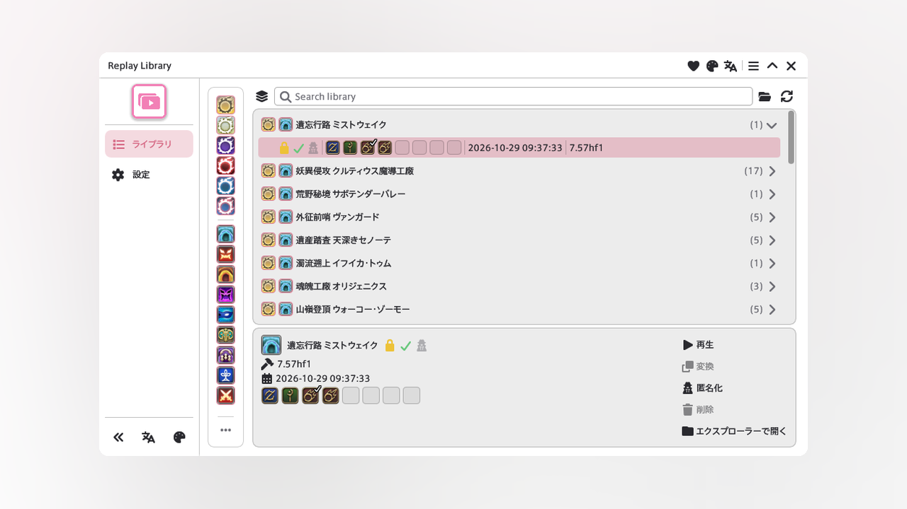

<p align="center">
  
</p>

<h1 align="center">Replay Library</h1>

<p align="center">
  English | <a href="docs/README.ja.md">日本語</a>
</p>

<p align="center">
  <a href="CHANGELOG.md">
    
  </a>
  <a href="LICENSE">
    
  </a>
</p>

<p align="center">
  
</p>

Replay Library records duty replays and files each one by content.

A finished recording goes to `replay/replaylibrary`. Play a current-patch replay from an inn. When Replay Converter is loaded, a replay can be converted to the current patch or anonymized. Those buttons stay disabled until Replay Converter is signed in. Opening Replay Converter files loose replays into `replay/replaylibrary`.

The first launch copies the whole `replay` folder to `replay-backup-yyyyMMdd-HHmmss` before it moves anything. That copy is kept.

## Install

1. Run `/xlsettings` and open the **Experimental** tab
2. Add this URL under **Custom Plugin Repositories**:

```
https://raw.githubusercontent.com/exatrines/DalamudPlugins/refs/heads/main/pluginmaster.json
```

3. Run `/xlplugins` and install **Replay Library**

## Features

- **Library** — Browse saved replays, filter them, and play a current-patch replay from an inn
- **Recording** — Record checked content types into `replay/replaylibrary`
- **Auto-lock** — Keep a set number of replays per duty, with cleared replays first
- **Auto-delete** — Move the rest to Deleted after a number of days, then trim that folder by size
- **Convert and anonymize** — Shown when Replay Converter is loaded. Disabled until that plugin is signed in
- **Language and themes** — English or Japanese, and window themes

## Commands

| Command | Description |
| --- | --- |
| `/lib` | Toggle the library window |
| `/lib config` | Toggle settings |

## For developers

[MirageUI](https://github.com/exatrines/MirageUI) is included as a submodule.

```
git submodule update --init --recursive
dotnet build ReplayLibrary.sln -c Release -p:Platform=x64
```

Set the dev plugin path to `ReplayLibrary/bin/Release/`, then enable it in the Dalamud installer.