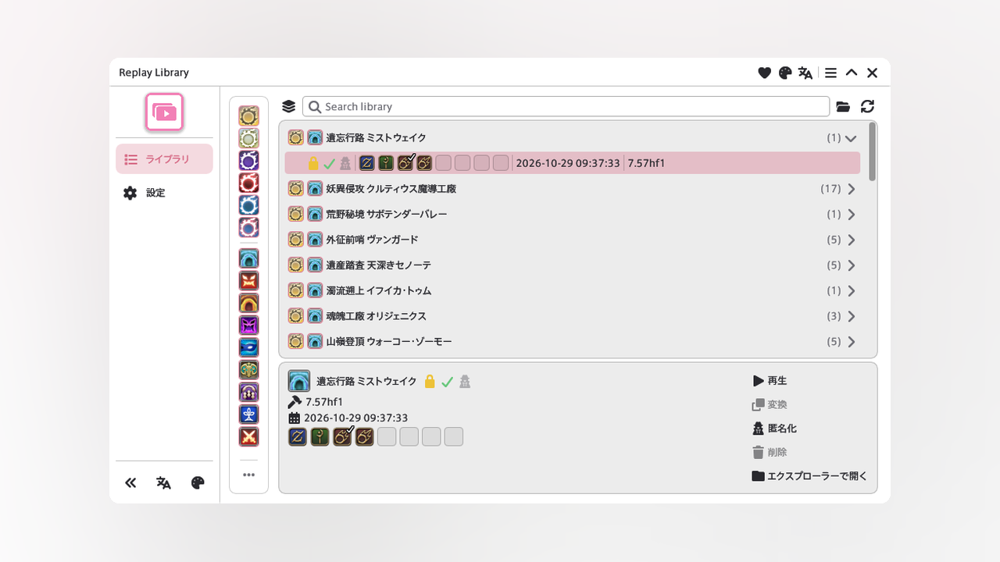

<p align="center">
  
</p>

<h1 align="center">Replay Library</h1>

<p align="center">
  <a href="../README.md">English</a> | 日本語
</p>

<p align="center">
  <a href="../CHANGELOG.md">
    
  </a>
  <a href="../LICENSE">
    
  </a>
</p>

<p align="center">
  
</p>

Replay Library は、コンテンツリプレイを録画し、コンテンツごとに保存します。

録画が終わると `replay/replaylibrary` に入ります。現行パッチのリプレイは、宿屋から再生できます。Replay Converter が読み込まれていると、現行パッチへの変換とパーティ名の匿名化が使えます。サインインするまでは、そのボタンは無効です。Replay Converter を開くと、散らばっているリプレイを `replay/replaylibrary` に整理します。

初回起動時は、移動の前に `replay` 一式を `replay-backup-yyyyMMdd-HHmmss` へコピーします。このコピーは残します。

## インストール

1. `/xlsettings` を実行し、**試験的機能**タブを開く
2. **カスタムプラグインリポジトリ** に次の URL を追加する:

```
https://raw.githubusercontent.com/exatrines/DalamudPlugins/refs/heads/main/pluginmaster.json
```

3. `/xlplugins` を実行し、**Replay Library** をインストールする

## 機能

- **ライブラリ** — 保存したリプレイを絞り込み、宿屋から現行パッチのリプレイを再生する
- **録画** — チェックしたコンテンツタイプを `replay/replaylibrary` に保存する
- **自動ロック** — コンテンツごとに残す数を決め、クリア済みを先に残す
- **自動削除** — それ以外を日数が過ぎたら Deleted へ移し、そのフォルダを容量で削る
- **変換と匿名化** — Replay Converter が読み込まれているとき表示する。サインインするまでは無効
- **言語とテーマ** — 英語と日本語、ウィンドウテーマ

## コマンド

| コマンド | 説明 |
| --- | --- |
| `/lib` | ライブラリウィンドウの表示切替 |
| `/lib config` | 設定の表示切替 |

## 開発者向け

[MirageUI](https://github.com/exatrines/MirageUI) はサブモジュールです。

```
git submodule update --init --recursive
dotnet build ReplayLibrary.sln -c Release -p:Platform=x64
```

開発用プラグインのパスを `ReplayLibrary/bin/Release/` にし、Dalamud のインストーラで有効にします。